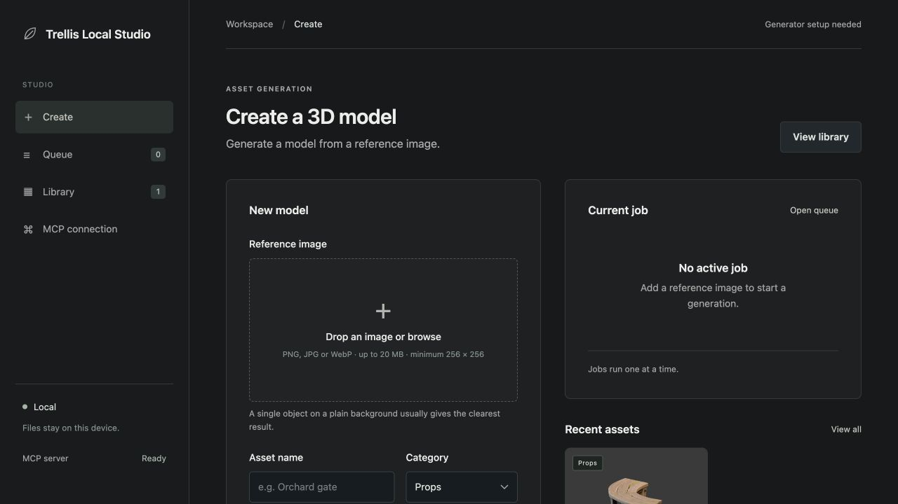
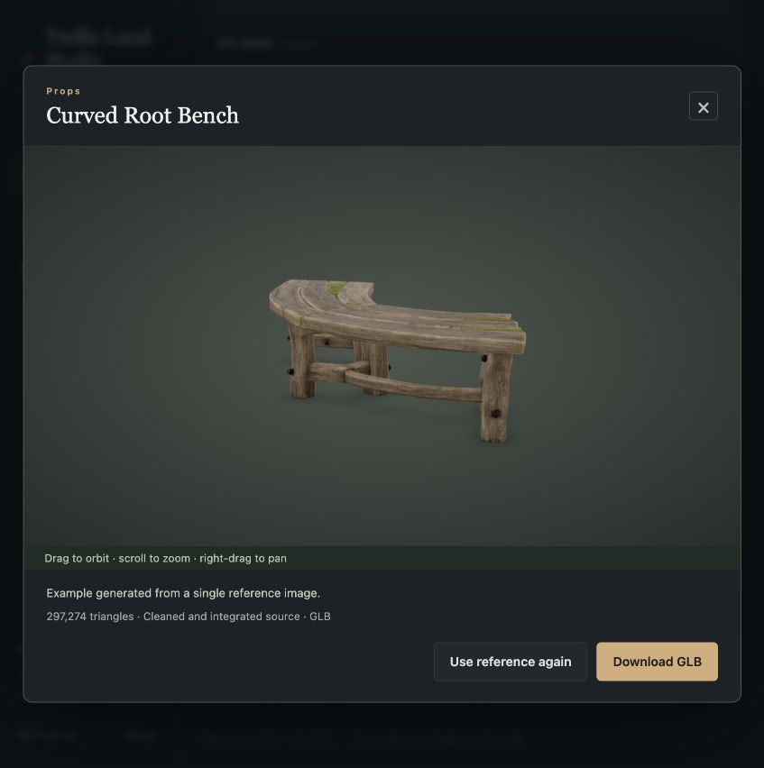
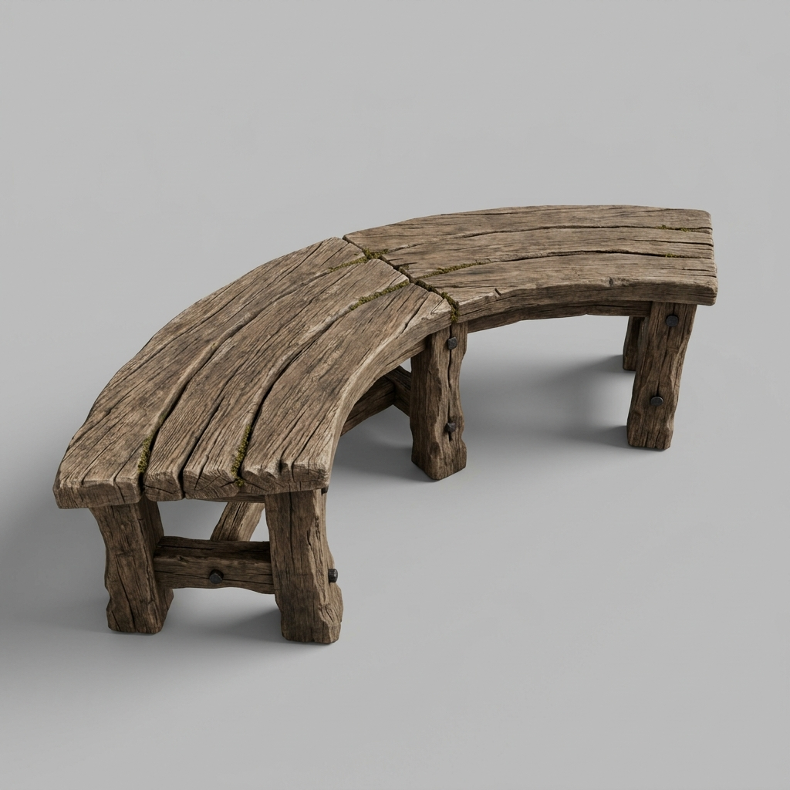
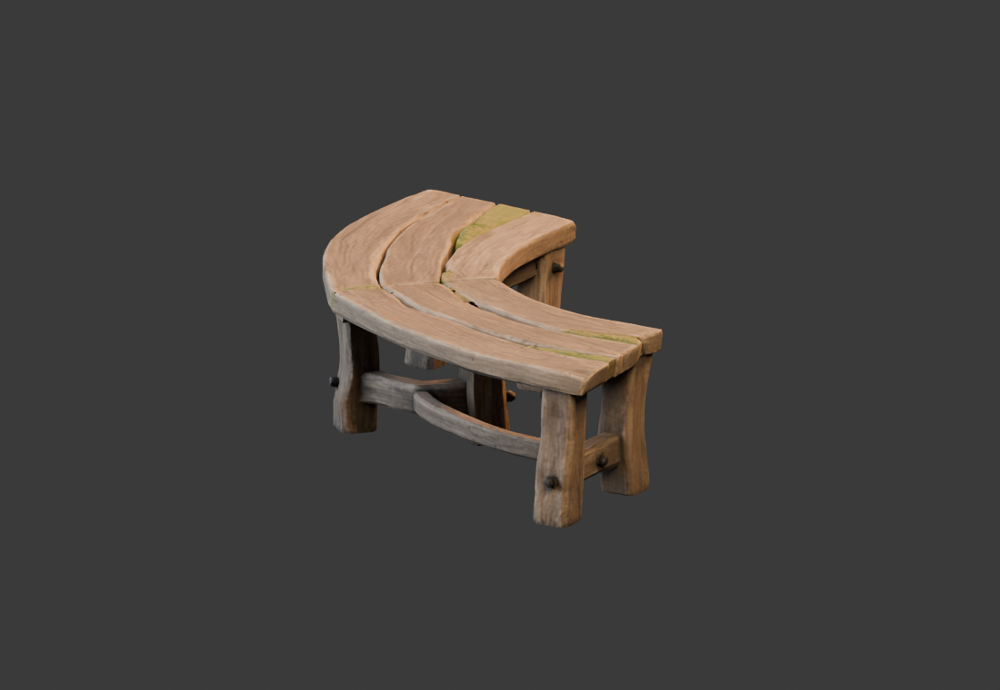

# TrellisLocalStudio

A small local image-to-3D studio with a durable generation queue, live logs, a model library, browser previews, and an MCP server. It runs the TRELLIS.2 MLX pipeline locally on Apple Silicon; references, generated models, logs, and queue data stay on the machine.

**Status:** first usable release, currently targeted at macOS on Apple Silicon with 16 GB or more unified memory. The application supports image-conditioned generation only; the notes field stores metadata and does not act as a text prompt.



The screenshot shows the local create screen and a sample library card. Open a model to orbit it in the interactive preview:



## Example: reference image to generated asset

This real TRELLIS.2 MLX result was generated from the single reference image below with the balanced profile. The right image is a studio render of the resulting textured GLB. It shows one run, not a promise that every generation will match the reference exactly; inspect geometry and textures before using a model in production.

| Input reference | Generated GLB render |
| --- | --- |
|  |  |

## Features

- Drop in a single-object PNG, JPEG, or WebP reference (under 20 MB, at least 256 px on each side).
- Choose a category, seed, memory cap, and quality profile.
- Persistent SQLite queue with one inference worker, reordering, pause, cancellation, retry, and restart recovery.
- View progress and real logs while generation runs in the background.
- Browse completed GLBs in an orbitable 3D viewer; download or reuse a reference.
- Connect an MCP client over stdio or Streamable HTTP to inspect and manage the same queue.
- Save every output and generation receipt in a per-job directory. The studio never installs generated files into another application.

The **balanced** profile is the tested default: 512 geometry resolution, unquantized sampling, 4K textures, 300K target faces, and a 10 GiB MLX limit. Detail and master profiles are experimental and may hit the memory cap. The generator preserves checkpoints on failure and does not silently substitute a lower quality setting.

## Requirements

- macOS on Apple Silicon; 16 GB unified memory minimum for the balanced profile (more memory is recommended).
- Python 3.11, `uv`, and Git.
- Access to the TRELLIS.2 MLX weights used by the pinned runner. The DINOv3 encoder is gated: request access to [facebook/dinov3-vitl16-pretrain-lvd1689m](https://huggingface.co/facebook/dinov3-vitl16-pretrain-lvd1689m) and authenticate locally with `hf auth login`. Never put a Hugging Face token in a config file or share it.
- Several tens of gigabytes free for model weights, caches, and generated 4K textures.

The included pipeline is based on [lyonsno/trellis2mlx](https://github.com/lyonsno/trellis2mlx), cloned at the pinned revision in `tools/trellis_local_runtime.py` during setup. The upstream source stays in the ignored local `vendor/` directory; only the files needed at runtime are copied into the user cache. Review the upstream license and instructions before use.

## Guided installation

```bash
git clone https://github.com/darthza/trellislocalstudio.git
cd trellislocalstudio
./install-asset-studio.command
```

Run the installer in Terminal on an Apple Silicon Mac. It checks memory and free storage, installs Python 3.11, `uv`, and Git with Homebrew when needed, prepares both Python environments, fetches the pinned generator source, and can launch the studio.

The installer then guides Hugging Face sign-in and model setup. Access to the gated [DINOv3 model](https://huggingface.co/facebook/dinov3-vitl16-pretrain-lvd1689m) must be approved on Hugging Face before its weights can download. The model files take substantial storage; cached files are reused. If access is still pending, the installer can finish the app setup and you can rerun it after approval.

Setup can be resumed by running `./install-asset-studio.command` again. The app opens at **http://127.0.0.1:8766** and runs locally after the browser closes. To stop it, send SIGTERM to the `asset_studio serve` process; the queue remains saved.

If Homebrew is not installed, the installer offers to run Homebrew's official installer, which may ask for your Mac password. You can decline, install it from [brew.sh](https://brew.sh), and rerun this installer.

## Manual installation

The guided installer is recommended. To prepare the same setup manually, install Python 3.11, `uv`, and Git with Homebrew:

```bash
brew install python@3.11 uv
brew install git
```

Set up the pinned generator source and inference environment. This downloads the upstream source into the ignored local `vendor/` directory and installs Python dependencies into a dedicated environment:

```bash
export TRELLIS_UPSTREAM_PYTHON="$(command -v python3.11)"
export TRELLIS_GENERATOR_PYTHON="$HOME/.cache/trellislocalstudio/trellis-venv/bin/python"
python3.11 tools/setup_local_trellis.py
```

Authenticate and download the model repositories. First request and receive access to the gated DINOv3 model linked above:

```bash
"$HOME/.cache/trellislocalstudio/trellis-venv/bin/hf" auth login
"$HOME/.cache/trellislocalstudio/trellis-venv/bin/hf" download microsoft/TRELLIS.2-4B
"$HOME/.cache/trellislocalstudio/trellis-venv/bin/hf" download microsoft/TRELLIS-image-large
"$HOME/.cache/trellislocalstudio/trellis-venv/bin/hf" download facebook/dinov3-vitl16-pretrain-lvd1689m
```

Launch the studio:

```bash
python3.11 tools/run_asset_studio.py open
```

The first generation loads local model weights and can take several minutes. If model downloads were skipped, rerun the guided installer after Hugging Face access is ready. Check the status panel and job logs if a profile is not ready.

## MCP connection

The local server is registered with Codex by running:

```bash
codex mcp add trellislocalstudio -- ./run-asset-studio-mcp.command
```

Restart or refresh the MCP client after registration. The stdio launcher starts the local service automatically and does not open a browser. For clients supporting Streamable HTTP, use:

```text
http://127.0.0.1:8766/mcp/
```

The MCP tools cover status, profiles, queue creation, job listing/details/logs, cancellation, retry, pause/reorder, and asset listing/details. `queue_asset` accepts an absolute local `image_path` or an existing uploaded `reference_id`.

## Configuration and stored data

Defaults:

- Studio database, references, outputs, and logs: `~/.local/share/trellislocalstudio/`
- Generator environment and cache: `~/.cache/trellislocalstudio/`
- Browser/API port: `8766`
- Model weights: Hugging Face's standard local cache

Override these with `TRELLIS_STUDIO_DATA`, `TRELLIS_STUDIO_PORT`, `TRELLIS_GENERATOR_PYTHON`, `TRELLIS_GENERATOR_CACHE`, `TRELLIS_VENDOR_DIR`, and `TRELLIS_DINOV3_ENCODER`. Set environment variables before launching the server and its stdio MCP process. The HTTP server binds only to loopback and rejects other website origins; do not expose it to a network interface without adding authentication.

Each completed job has `output/model.glb`, `output/run.json`, attempt logs, and portable master checkpoints. Failed/interrupted attempts are preserved. Retry creates a new job and output folder. Back up the data directory if you want to preserve the queue and library.

## Development

```bash
python3.11 -m unittest asset_studio.test_studio asset_studio.test_mcp -v
node --check asset_studio/static/app.js
```

The tests use disposable temporary data and tiny fixtures; they do not run model inference. Keep large weights, references, generated GLBs, logs, virtual environments, and credentials outside Git.

## License

Application code is MIT licensed; see [LICENSE](LICENSE). The bundled `model-viewer` distribution retains its Apache-2.0 license and notice in `asset_studio/static/vendor/`.
